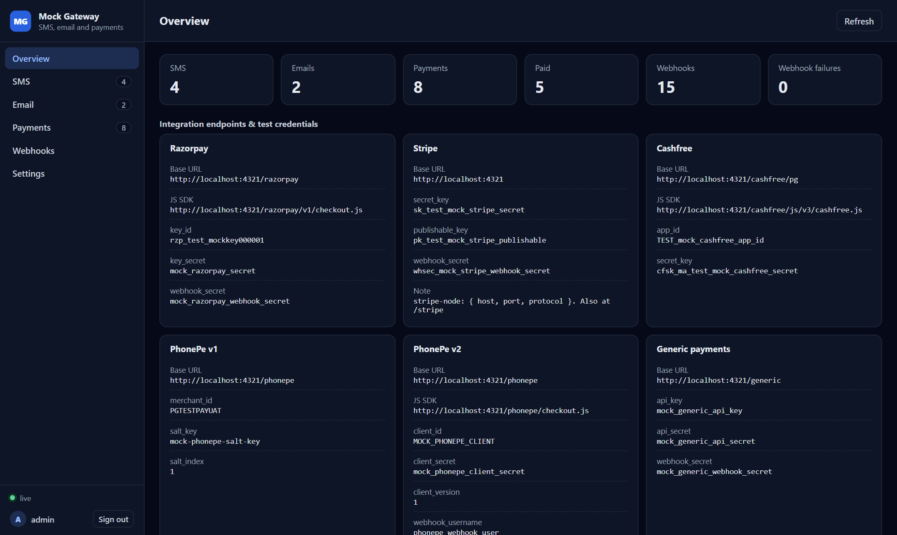
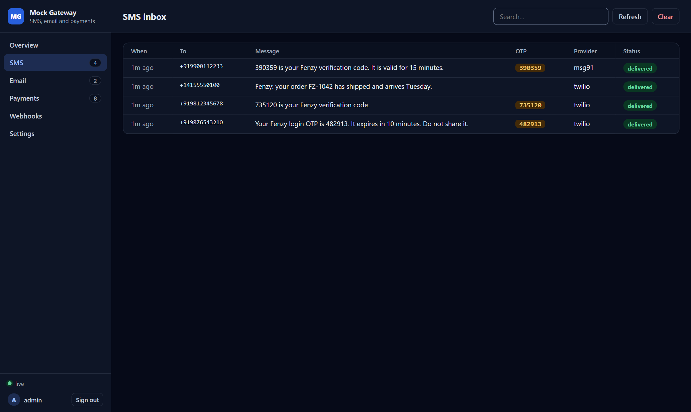
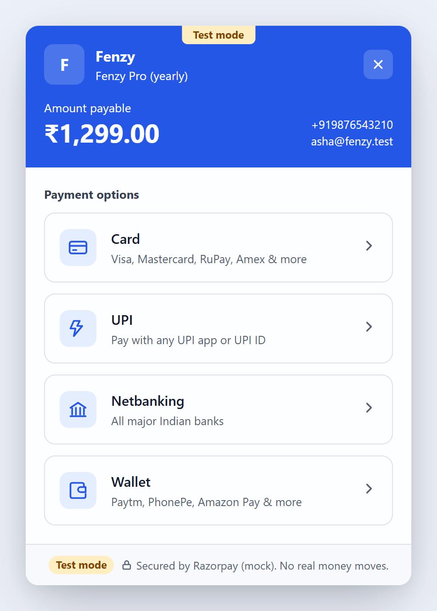
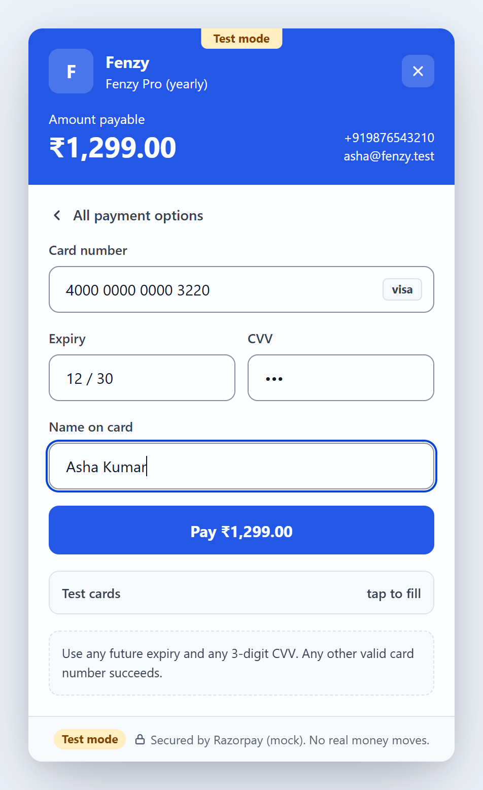
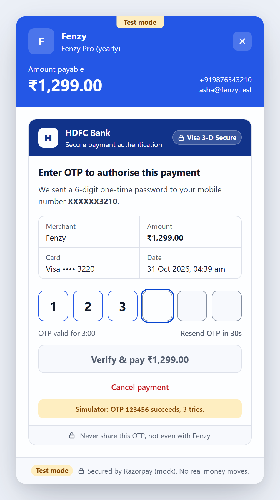
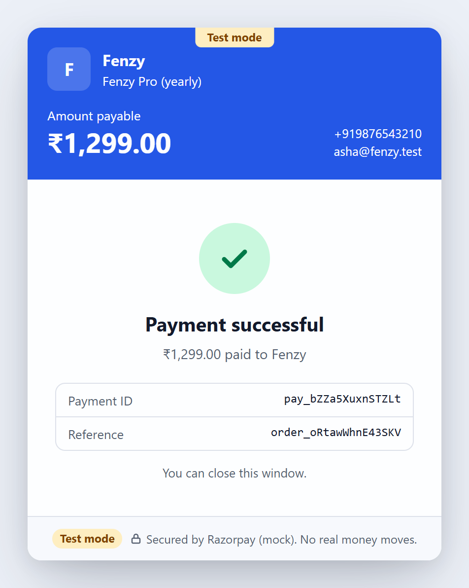
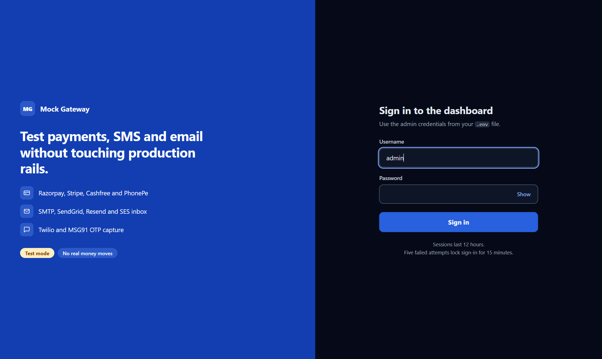

# Fenzy Mock Gateway

A self-hosted **mock SMS, Email and Payment gateway** for testing Fenzy end to end without real money, real SMS or real email.

It copies the **real provider APIs**, so the app keeps its normal integration code. In test you change only the **base URL and keys**.

| Area | Providers emulated |
|---|---|
| Payments | **Razorpay** (orders, payments, capture, refunds, payment links, `checkout.js`), **Stripe** (PaymentIntents, 3DS, Checkout Sessions, refunds, customers, events, idempotency), **Cashfree PG** (2023-08-01 orders/payments/refunds, `cashfree.js`), **PhonePe** v1 (X-VERIFY) and v2 (OAuth, `PhonePeCheckout`), **Generic** REST API |
| SMS / OTP | **Twilio** Messaging + Verify v2, **MSG91** (Flow, OTP send/verify/retry, sendhttp), **Generic** SMS/OTP API |
| Email | **SMTP** capture server, **SendGrid** v3, **Resend**, **AWS SES** v2 + v1 Query API, **Generic** email API |

It also includes:

- **Hosted checkout** for real-looking payments: card (Luhn check, brand detection, 3-D Secure OTP), UPI (collect, intent and QR), netbanking (simulated bank login), and wallets. The page works as a full-page redirect or as an in-page modal opened by the mock SDKs. A **TEST MODE** banner is always shown.
- **Signed webhooks** that use each provider's real signature scheme. They are stored durably, retried with backoff, and can be redelivered from the dashboard.
- A **dashboard** (`/dashboard`) with live SMS and email inboxes, detected OTPs and links, a payment explorer that can simulate success, failure or refund, a webhook log, and runtime settings.
- An **admin API** (`/api/*`) for automated tests. For example, you can read the OTP that was "sent" to a phone number.
- One Docker container, SQLite storage, no external dependencies.

---

## Screenshots

**Dashboard**: integration endpoints and test credentials, live SMS and email inboxes with the OTP pulled out, payments and webhooks.





**Hosted checkout**: what Fenzy's users see when they pay. It opens from the mock `checkout.js` / `cashfree.js` / `PhonePeCheckout` SDKs, or as a redirect.

<table>
  <tr>
    <td width="25%"></td>
    <td width="25%"></td>
    <td width="25%"></td>
    <td width="25%"></td>
  </tr>
  <tr>
    <td><sub>1. Choose a method</sub></td>
    <td><sub>2. Card details (test cards one tap away)</sub></td>
    <td><sub>3. Bank OTP: <code>123456</code> succeeds, 3 attempts</sub></td>
    <td><sub>4. Paid; Fenzy gets the callback and a signed webhook</sub></td>
  </tr>
</table>

**Sign in**: the dashboard and admin API sit behind a login page with a session cookie and lockout.



---

## Quick start (Docker)

```bash
cp .env.example .env          # set ADMIN_PASSWORD and PUBLIC_URL at minimum
docker compose up -d --build
open http://localhost:4000/dashboard     # sign in with ADMIN_USERNAME / ADMIN_PASSWORD
```

| Port | Purpose |
|---|---|
| `4000` | HTTP: provider APIs, checkout pages, SDK scripts, dashboard, admin API |
| `2525` | SMTP capture |

Data is stored in the `mock-gateway-data` volume (`/data/mock-gateway.db`). Records older than `RETENTION_DAYS` (default 7) are deleted automatically.

Local without Docker (Node ≥ 22.13): `npm ci && npm start`. Tests: `npm test`.

---

## Hosting it in production

1. **Put it on its own subdomain behind HTTPS**, for example `https://mock-gateway.fenzy.example`. Set `PUBLIC_URL` to that URL; checkout links and SDK scripts are built from it. Set `TRUST_PROXY=1` when one reverse proxy (nginx, Caddy, ALB) sits in front.
2. **Always set `ADMIN_PASSWORD`.** If it is not set, a random password is generated and printed in the logs on every start. Set `ADMIN_API_TOKEN` if CI needs `/api`.
   - The dashboard uses a sign-in page with a signed, HttpOnly session cookie (12 hours). Changing `ADMIN_PASSWORD` signs everyone out.
   - After 5 failed sign-ins from one IP, that IP is locked out for 15 minutes.
   - Dashboard write requests must carry an `X-Requested-With` header, which blocks cross-site form posts.
3. **Change all mock credentials** in `.env` so they differ from the public defaults. The mock checks them exactly like the real gateway would.
4. Expose SMTP (`2525`) only to your app's network if possible. Set `SMTP_USERNAME`/`SMTP_PASSWORD` to require SMTP authentication.
5. Point the app at the mock **only in the test/staging configuration**. Every page shows **TEST MODE**, and no real money, SMS or email ever leaves this server.
6. Moving to a cloud later: the image is stateless apart from `/data`. Mount a persistent disk there (Cloud Run with a volume, ECS with EFS, Fly volume, a Render disk, and so on) and run **one instance**, because SQLite is single-writer.

Health check: `GET /health` returns `{ status, version, uptime }`. Logs are JSON lines on stdout. With `NODE_ENV=production`, which the Docker image sets, the server **refuses to start** if `ADMIN_PASSWORD` is unset, shorter than 12 characters, or still the example value.

### Where it can run

The server is a long-running Node.js process. It needs persistent disk for `/data`, and for SMTP it needs a TCP port.

| Host | Works? | Notes |
|---|---|---|
| **Any VM with Docker** (Oracle Cloud Always Free, Google Cloud e2-micro free tier, any VPS) | ✅ Recommended | Use `docker-compose.prod.yml` (Caddy provides automatic HTTPS). Everything works, including SMTP. Oracle's free Ampere VMs are ARM, and the published image supports ARM. |
| **Render** (free) | ⚠️ HTTP only | Use `render.yaml`. The instance sleeps when idle, and the disk is wiped on every deploy or restart. SMTP is unavailable; use the email APIs instead. |
| **PHP shared hosting** (InfinityFree, 000webhost, cPanel shared plans) | ❌ | These hosts have no Node.js, no Docker and no long-running processes. InfinityFree also puts a JavaScript "browser check" page in front of every request, which breaks server-to-server API calls and webhooks. |

---

## CI/CD

| Workflow | Trigger | What it does |
|---|---|---|
| `.github/workflows/ci.yml` | Push to `main`, pull requests | Lint, tests on Node 22 and 24, `npm audit`, Docker build, live smoke test (`scripts/smoke-test.sh`), Trivy image scan |
| `.github/workflows/release.yml` | Push tag `vX.Y.Z` (or run manually with a tag) | Checks the tag matches `package.json`, runs CI, pushes `ghcr.io/<owner>/<repo>:X.Y.Z` (`X.Y` and `latest` too; amd64 and arm64), creates a GitHub Release from `CHANGELOG.md`, deploys, then polls `/health` until the new version is live |
| `.github/dependabot.yml` | Weekly | Updates for npm, Actions and the base image |

### One-time setup

1. Push this repo to GitHub, using `main` as the default branch.
2. In **Settings → Environments**, create `test-prod`. Add **required reviewers** if you want to approve each deploy. Then set:
   - Variable `PUBLIC_URL`: the public URL of the deployment, used to verify the deployed version.
   - **VM deploy:** secrets `DEPLOY_HOST`, `DEPLOY_USER`, `DEPLOY_SSH_KEY` (a private key whose public half is in the VM user's `authorized_keys`), and optionally `DEPLOY_PORT`. Optional variable `DEPLOY_PATH` (default `/opt/fenzy-mock-gateway`).
   - **Render deploy instead:** secret `RENDER_DEPLOY_HOOK_URL` (Render → service → Settings → Deploy Hook).
   - If neither is set, releases still publish the image and the GitHub Release, and the deploy step is skipped with a warning.
3. **VM only, once:** install Docker and open ports 80 and 443 (plus 2525 for SMTP). Create the deploy folder:
   ```bash
   sudo mkdir -p /opt/fenzy-mock-gateway && sudo chown $USER /opt/fenzy-mock-gateway
   # copy .env.example to /opt/fenzy-mock-gateway/.env and fill it in (DOMAIN, PUBLIC_URL=https://DOMAIN, ADMIN_PASSWORD, keys)
   ```
   Point the DNS A record for `DOMAIN` at the VM. Caddy obtains the TLS certificate on the first start.

### Cutting a release

```bash
# 1. In CHANGELOG.md, move the "Unreleased" notes under a new "## [X.Y.Z] - date" heading
git commit -am "docs: changelog for X.Y.Z"
# 2. Bump package.json, then commit and tag vX.Y.Z (use patch / minor / major)
npm version minor
# 3. Push; the tag triggers the Release workflow
git push origin main --follow-tags
```

Run `npm run check` (lint and tests) before pushing. To roll back, run the **Release** workflow manually with the previous tag.

---

## Integrating Fenzy

All defaults below come from `.env.example`. Replace `$MOCK` with your `PUBLIC_URL`.

### Razorpay

```js
const Razorpay = require('razorpay');
const rzp = new Razorpay({ key_id: process.env.RAZORPAY_KEY_ID, key_secret: process.env.RAZORPAY_KEY_SECRET });
if (process.env.RAZORPAY_BASE_URL) rzp.api.rq.defaults.baseURL = process.env.RAZORPAY_BASE_URL; // = $MOCK/razorpay
```

In the frontend, load `$MOCK/razorpay/v1/checkout.js` instead of `https://checkout.razorpay.com/v1/checkout.js`. It exposes the same `new Razorpay(options).open()` API, with `handler`, `modal.ondismiss`, `rzp.on('payment.failed')`, `callback_url` and `redirect`.

Signatures are computed like Razorpay's: `HMAC_SHA256(order_id|payment_id, key_secret)`. Webhooks send `X-Razorpay-Signature` with `HMAC_SHA256(body, RAZORPAY_WEBHOOK_SECRET)`.

Events: `payment.authorized`, `payment.captured`, `order.paid`, `payment.failed`, `refund.created`, `refund.processed`, `payment.refunded`, `payment_link.paid`.

### Stripe

```js
const stripe = new Stripe(process.env.STRIPE_SECRET_KEY, process.env.STRIPE_MOCK_HOST
  ? { host: process.env.STRIPE_MOCK_HOST, port: 443, protocol: 'https' } : {});
```

- Test payment methods: `pm_card_visa`, `pm_card_mastercard`, `pm_card_chargeDeclined`, `pm_card_chargeDeclinedInsufficientFunds`, `pm_card_chargeDeclinedExpiredCard`, `pm_card_chargeDeclinedIncorrectCvc`, `pm_card_chargeDeclinedProcessingError`, `pm_card_threeDSecure2Required`. The `tok_*` equivalents also work.
- 3DS returns `next_action.redirect_to_url.url`, which points to the mock's authentication page. It then redirects to `return_url?payment_intent=…&redirect_status=…`.
- Checkout Sessions (`mode=payment`, `line_items[].price_data`) return a `url` to the hosted page. `{CHECKOUT_SESSION_ID}` in `success_url` is filled in.
- Webhooks are signed with `Stripe-Signature` (`t=…,v1=…`), so `stripe.webhooks.constructEvent(body, sig, STRIPE_WEBHOOK_SECRET)` works unchanged.
- Stripe.js / Elements cannot be mocked. Use Checkout Sessions, or PaymentIntents with the hosted page `$MOCK/checkout/stripe/{pi_id}?return_url=…`.

### Cashfree

- API base: `$MOCK/cashfree/pg`, used in place of `https://sandbox.cashfree.com/pg`. Send the headers `x-client-id`, `x-client-secret` and `x-api-version`.
- Frontend: load `$MOCK/cashfree/js/v3/cashfree.js` and call `Cashfree({mode:'sandbox'}).checkout({ paymentSessionId, redirectTarget: '_self' | '_modal' })`.
- After payment the user is redirected to `order_meta.return_url` (`{order_id}` is filled in).
- Webhooks are sent to `order_meta.notify_url`, or to `CASHFREE_WEBHOOK_URL` if the order has none. They carry `x-webhook-signature = base64(HMAC_SHA256(timestamp + body, secret))` and `x-webhook-timestamp`.

### PhonePe

- **v1 (salt key):** base `$MOCK/phonepe`. Endpoints: `POST /pg/v1/pay`, `GET /pg/v1/status/{mid}/{txnId}`, `POST /pg/v1/refund`.
  - X-VERIFY is checked exactly: `sha256(base64 + path + saltKey) + "###" + saltIndex`.
  - S2S callback: `{response: base64}` with an `X-VERIFY` header. The user returns to `redirectUrl` (POST or REDIRECT mode).
- **v2 (OAuth):** base `$MOCK/phonepe`. Endpoints: `POST /v1/oauth/token`, `POST /checkout/v2/pay`, `GET /checkout/v2/order/{id}/status`, `POST /payments/v2/refund`, `GET /payments/v2/refund/{id}/status`.
  - Production-style `/apis/pg/...` paths work too.
  - Webhook `Authorization` is `sha256(username:password)`.
  - Iframe mode: load `$MOCK/phonepe/checkout.js` and call `PhonePeCheckout.transact({ tokenUrl, type: 'IFRAME', callback })`.

### Generic payments (`Authorization: Bearer GENERIC_API_KEY`)

```http
POST $MOCK/generic/payments   {"amount":49900,"currency":"INR","order_id":"F-1","return_url":"https://app/return","webhook_url":"https://app/hooks"}
→ 201 {"id":"gp_…","checkout_url":"$MOCK/checkout/generic/gp_…", ...}
GET  $MOCK/generic/payments/{id|order_id}
POST $MOCK/generic/payments/{id}/refund   {"amount":1000}
```

- Return redirect: `return_url?payment_id&order_id&status&signature`, where `signature = HMAC_SHA256(id|status, GENERIC_API_SECRET)`.
- Webhooks carry `X-Mock-Signature = HMAC_SHA256(body, GENERIC_WEBHOOK_SECRET)`.

### Twilio

```js
const client = twilio(process.env.TWILIO_ACCOUNT_SID, process.env.TWILIO_AUTH_TOKEN);
if (process.env.TWILIO_BASE_URL) {             // = $MOCK/twilio
  client.api.baseUrl = process.env.TWILIO_BASE_URL;
  client.verify.baseUrl = process.env.TWILIO_BASE_URL;
}
```

- **Messages:** delivery moves through `queued → sent → delivered`. `StatusCallback` is called with a valid `X-Twilio-Signature`.
- **Magic numbers:** `+15005550001` (invalid number), `+15005550002` (unreachable), `+15005550009` (not a mobile).
- **Verify v2:** `verifications.create` sends the code to the SMS inbox (or the email inbox for `channel: 'email'`). `verificationChecks.create` returns `approved` or `pending`, as Twilio does.

### MSG91

Base `$MOCK/msg91`, used in place of `https://control.msg91.com`. Send the `authkey` header.

- **Endpoints:** `POST /api/v5/flow`, `/api/v5/otp`, `/api/v5/otp/verify`, `/api/v5/otp/retry`, `/api/sendhttp.php`, `/api/v2/sendsms`.
- **Templates:** to render your real templates, set `MSG91_TEMPLATES={"<template_id>":"Your OTP is ##otp##"}`.
- **Delivery reports:** set `MSG91_DLR_URL`.

### Generic SMS / OTP / email

```http
POST $MOCK/generic/sms         {"to":"+919876543210","message":"Hello"}
POST $MOCK/generic/otp/send    {"to":"+919876543210"}            (or an email address)
POST $MOCK/generic/otp/verify  {"to":"+919876543210","code":"123456"}
POST $MOCK/generic/email       {"from":"a@x","to":"b@y","subject":"Hi","html":"<p>Hi</p>"}
```

### Email

| Provider | Configuration |
|---|---|
| SMTP (Nodemailer, etc.) | `host=<mock host>`, `port=2525`, `secure=false`. Any credentials are accepted unless `SMTP_USERNAME`/`SMTP_PASSWORD` are set. |
| SendGrid | `client.setDefaultRequest('baseUrl', '$MOCK/sendgrid'); sgMail.setClient(client)` |
| Resend | `RESEND_BASE_URL=$MOCK/resend` |
| AWS SES v2 | `new SESv2Client({ endpoint: '$MOCK/ses', region, credentials })` (signatures are not verified) |

Captured email shows the HTML preview, text, headers, attachments, detected OTP and links.

---

## Test data

| Card | Result |
|---|---|
| `4111 1111 1111 1111`, `4242 4242 4242 4242`, `5555 5555 5555 4444`, any Luhn-valid number | Success |
| `4000 0000 0000 3220`, `5200 0000 0000 1096` | Issuer OTP page. `123456` succeeds. A wrong OTP allows 3 attempts, then the payment is declined. The OTP expires after 3 minutes, and resend unlocks after 30 seconds. |
| `4000 0000 0000 0002` | Declined |
| `4000 0000 0000 9995` | Insufficient funds |
| `4000 0000 0000 0069` | Expired card |
| `4000 0000 0000 0127` | Incorrect CVV |
| `4000 0000 0000 0119` | Processing error |

- **UPI:** `success@upi` approves immediately. `failure@upi` (or any ID starting with `fail`) is declined. Any other ID waits for approval and auto-approves after `checkout.upiAutoApproveSeconds`.
- **Netbanking and wallets:** the simulated bank or wallet page has **Success** and **Failure** buttons.

---

## Admin API (for automated E2E tests)

Auth: HTTP Basic (`ADMIN_USERNAME:ADMIN_PASSWORD`), `Authorization: Bearer $ADMIN_API_TOKEN`, or the dashboard session cookie.

| Endpoint | Use |
|---|---|
| `GET /api/sms/latest?to=9876543210` | Latest SMS to a number. The response includes the `otp` field. Matching uses the last 10 digits, so `+91…` and bare numbers both match. |
| `GET /api/sms?to=&q=&since=&limit=` | Search SMS |
| `GET /api/emails/latest?to=user@x.com` | Latest email, including `otp`, `links`, `html` and `text` |
| `GET /api/emails?to=&subject=&q=` | Search email |
| `GET /api/otps?recipient=` | OTP codes issued by Twilio Verify, MSG91 and the generic API |
| `GET /api/payments?provider=&status=&q=` | List payments |
| `GET /api/payments/:id` | Native object, related objects and webhooks for one payment |
| `POST /api/payments/:id/simulate` `{"outcome":"success"\|"failed","method":"card\|upi\|netbanking\|wallet","error":"insufficient_funds"}` | Complete a payment without a browser. Returns the same `next` redirect the browser would follow. |
| `POST /api/payments/:id/refund` `{"amount":1000}` | Refund through the provider's own logic |
| `GET /api/webhooks`, `POST /api/webhooks/:id/retry` | Inspect or redeliver webhooks |
| `GET/PUT /api/settings` | Webhook URLs, artificial latency, random 5xx failure rate, SMS delivery status, UPI auto-approve |
| `POST /api/reset` `{"scope":"all\|sms\|emails\|otps\|payments\|webhooks"}` | Wipe data between test runs |
| `GET /api/stream` | Server-sent events for live updates |

Example: Playwright login with an OTP.

```js
await page.fill('#phone', '9876543210');
await page.click('text=Send OTP');
const { otp } = await (await request.get(`${MOCK}/api/sms/latest?to=9876543210`, { headers: { Authorization: `Bearer ${TOKEN}` } })).json();
await page.fill('#otp', otp);
```

---

## Project layout

```
src/
  server.js, app.js, config.js, db.js (node:sqlite), webhooks.js (durable queue), settings.js, store.js
  payments/  razorpay, stripe, cashfree, phonepe, generic, simulator (outcome rules), checkout (pages + SDKs)
  sms/       twilio, msg91, generic (SMS/OTP/email)
  email/     smtp (capture server), http (SendGrid, Resend, SES)
  admin/     api.js (dashboard + test automation API, retention)
public/      checkout.* and dashboard.* (vanilla JS, no build step)
test/        e2e.test.js: end-to-end tests across every provider
scripts/     smoke-test.sh (container checks used by CI), release-notes.mjs
deploy/      Caddyfile for docker-compose.prod.yml
.github/     CI, Release and Dependabot configuration
```
